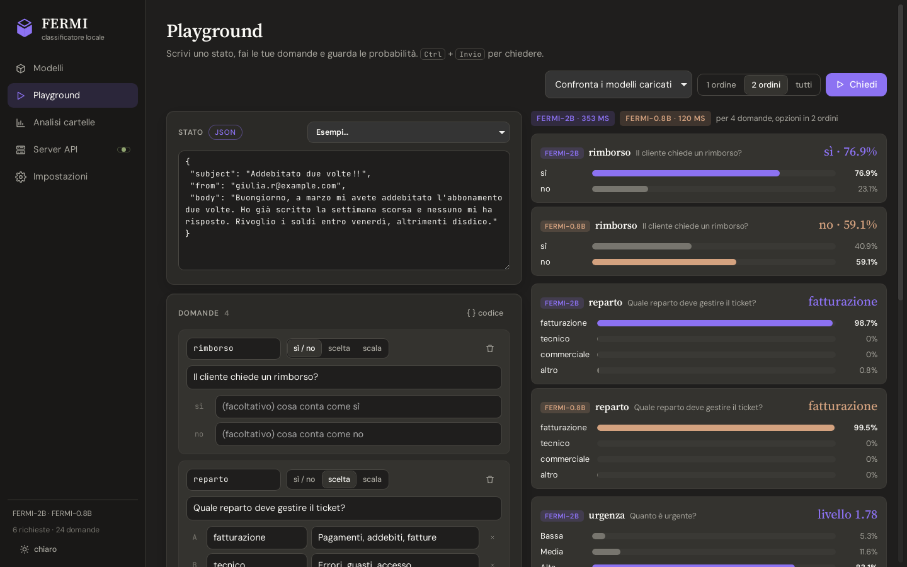
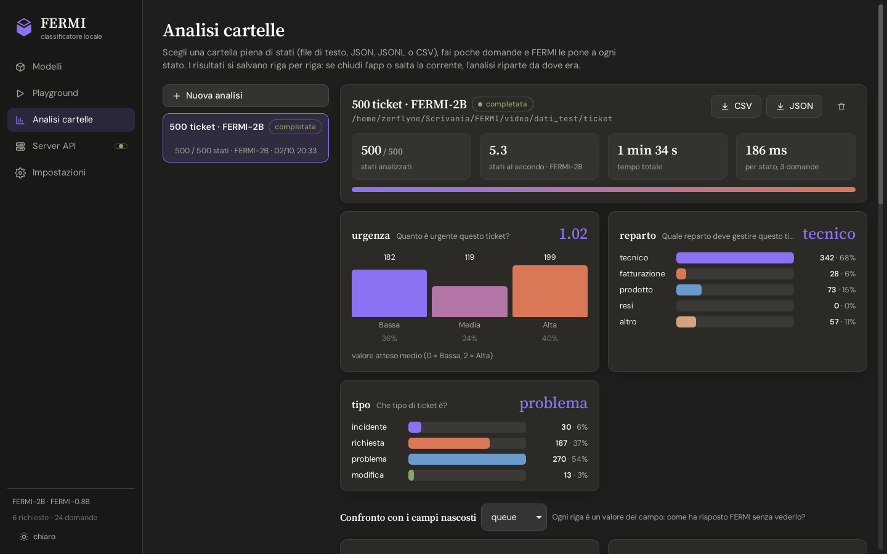
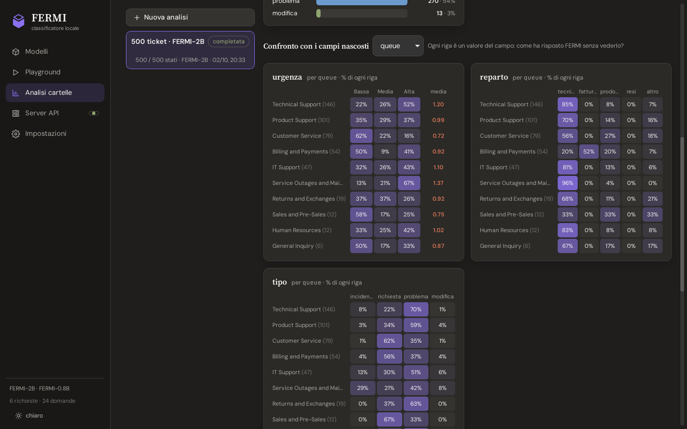
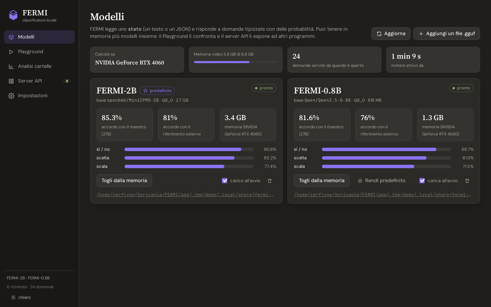
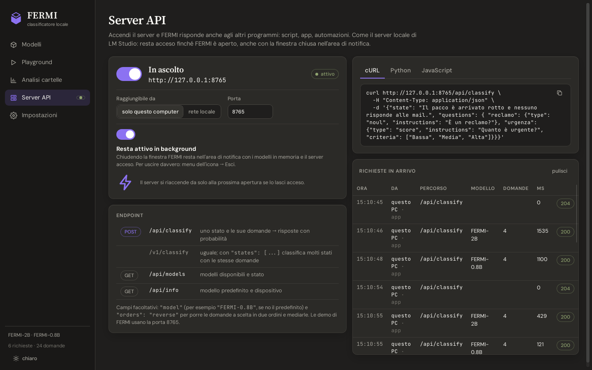
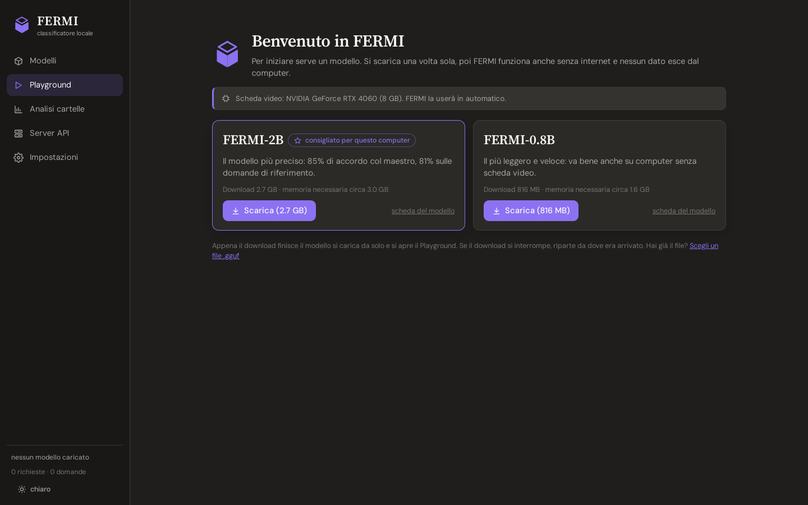

<p align="center"></p>

# FERMI app

**FERMI** is a small open classifier: it reads a **state** (any text or JSON) and answers typed questions about it
(yes/no, choice, scale) with **probabilities**. The models are on Hugging Face
([FERMI-2B](https://huggingface.co/Zerflyne/FERMI-2B), [FERMI-0.8B](https://huggingface.co/Zerflyne/FERMI-0.8B));
this repository is the desktop app that runs them.

The app runs on Linux, Windows and macOS, with or without a graphics card. You install it, download a model from the app on the first start, and it is ready.

- **Models**: the models on this computer, with their evaluation, memory use, load/unload and "load at start", plus the
  ones you can download (with progress, resume and cancel). Several models can stay in memory at once.
- **Playground**: a state (text or JSON), typed questions (yes/no, choice, scale), probability bars; ready-made
  examples; the same question to every loaded model side by side; the request as `curl`.
- **Folder analysis**: a folder of `.txt .md .eml .log .json .jsonl .csv .tsv` (one state per file, per line or per
  row), a few questions, and FERMI asks them of every state. Live charts per question, cross-filters (click a bar),
  a sortable table, the full state of every row, CSV/JSON export. Fields can be **hidden from the model** and kept as
  metadata, to compare FERMI with labels you already have. Results are written line by line: an analysis interrupted
  by closing the app or a power cut resumes where it stopped.
- **API server**: on/off switch, port, this computer only or the local network (with an API key for other computers),
  request log, examples in curl, Python and JavaScript. With "stay in the background" the window closes to the tray
  and the models and the server stay on, like LM Studio's server.

The UI is in Italian.



| | |
|---|---|
|  |  |
| **Folder analysis**: 500 support tickets, three questions, 1.5 minutes on an RTX 4060 | **Hidden fields**: FERMI's answers against the labels it did not see |
|  |  |
| **Models**: evaluation, memory, device, load at start | **API server**: local or LAN, request log, code examples |
|  | |
| **First start**: the app picks and downloads the right model | |

## Install

Download the installer for your system from the [Releases](https://github.com/Zerflyne/FERMI/releases) page:

| System | File | Notes |
|---|---|---|
| Windows 10/11 | `FERMI_x.y.z_x64-setup.exe` | SmartScreen may warn about an unknown publisher: *More info → Run anyway*. |
| macOS (Apple Silicon or Intel) | `FERMI_x.y.z_aarch64.dmg` / `_x64.dmg` | The app is not notarized: the first time, right-click the app → *Open*, or *System Settings → Privacy & Security → Open Anyway*. |
| Ubuntu, Debian, Mint | `FERMI_x.y.z_amd64.deb` | `sudo apt install ./FERMI_x.y.z_amd64.deb` |
| Any other Linux | `FERMI_x.y.z_amd64.AppImage` | Make it executable and run it. |

On the first start the app suggests the model that suits the computer (FERMI-2B with a graphics card that can hold it,
FERMI-0.8B otherwise) and downloads it from Hugging Face ([FERMI-2B](https://huggingface.co/Zerflyne/FERMI-2B),
[FERMI-0.8B](https://huggingface.co/Zerflyne/FERMI-0.8B)). After that it works offline and no data leaves the computer.

Where it runs:

- **Graphics cards**: NVIDIA, AMD and Intel through Vulkan on Windows and Linux (the usual graphics driver is
  enough), Apple GPUs through Metal on macOS. The app picks the card on its own; Settings can force one, or the CPU.
- **CPU only**: always works (64-bit Intel/AMD processors on Windows and Linux, Apple Silicon and Intel on macOS; the
  fastest instruction set of the processor is picked at run time). Slower: about half a second per question with FERMI-0.8B on a recent desktop processor.

| Model | Download | Memory to run | Agreement with the teacher |
|---|---|---|---|
| FERMI-2B | 2.7 GB | about 3 GB | 85% |
| FERMI-0.8B | 0.8 GB | about 1.6 GB | 82% |

Settings, models, analyses and results live in `~/.local/share/fermi-app` (Linux), `%APPDATA%\FERMI` (Windows),
`~/Library/Application Support/FERMI` (macOS).

## API

The app answers on `127.0.0.1:8767`; the API server (switched on from the app) on `127.0.0.1:8765` by default.

```bash
curl http://127.0.0.1:8765/api/classify -H "Content-Type: application/json" -d '{
  "model": "FERMI-2B",
  "state": "Il pacco è arrivato rotto e nessuno risponde alle mie email. Rivoglio i soldi.",
  "questions": {"complaint": {"type": "noul", "instructions": "Is the customer complaining?"}}}'
```

Optional fields: `"model"` (id, name or size; default: the default model), `"orders": "reverse"` or `"all"` (choice
questions asked with the options in several orders and averaged, against position bias), `"states": [...]` instead of
`"state"` to classify many states with the same questions. `GET /api/models`, `GET /api/info`.

Without a window, for servers:

```bash
fermi-app --headless [--port 8767] [--data DIR] [--load fermi-2b]
```

## How it works

```
FERMI app (one program, Rust + Tauri)
 ├─ window: React UI (src/)                       ──HTTP──▶  127.0.0.1:8767
 ├─ engine (src-tauri/src/engine)
 │    ├─ the FERMI prompt, the decision head, the answers, folder analyses, model downloads
 │    ├─ app port 127.0.0.1:8767, API server 127.0.0.1:8765
 │    └─ llama.cpp, loaded at run time from runtime/  ──▶  Vulkan / Metal / CPU modules
 └─ tray icon, settings, file dialogs
```

A model is a single `.gguf` file: the base model with FERMI's LoRA merged in, quantized to Q8_0, with the decision head
and FERMI's configuration stored in the file's metadata (`fermi.*`). FERMI reads the final hidden states at the end of
each option and at the end of the prompt; the small head turns them into probabilities. llama.cpp computes only those
positions (see `runtime/patches/`).

The llama.cpp runtime (`runtime/`) is built with every GPU backend of the platform as a loadable module and every CPU
variant; whatever the computer cannot use is skipped. The app checks this against PyTorch with `tools/compare.py`.

## Build

You need Node 20+, Rust, CMake, a C++ compiler and, on Windows and Linux, the Vulkan SDK.

```bash
npm install
runtime/build.sh path/to/llama.cpp     # llama.cpp at the commit in runtime/LLAMA_COMMIT; output in runtime/dist
npm run tauri dev                     # development, with hot reload of the UI
npm run tauri build                   # installers in src-tauri/target/release/bundle
```

Linux also needs the usual Tauri libraries (`libwebkit2gtk-4.1-dev`, `libgtk-3-dev`, `libayatana-appindicator3-dev`,
`librsvg2-dev`). The GitHub workflow `.github/workflows/build.yml` builds the installers for all three systems.

Tools for making model files (`tools/`): `merge_lora.py` (merge a FERMI checkpoint into its base model),
`pack_fermi.py` (put the head and the configuration into the `.gguf`), `compare.py` (llama.cpp against PyTorch on the
evaluation questions).

The UI alone runs in a browser against a running app or headless engine: `npm run dev`, then http://localhost:5173
(folder pickers become text prompts).

## License

Apache-2.0.
